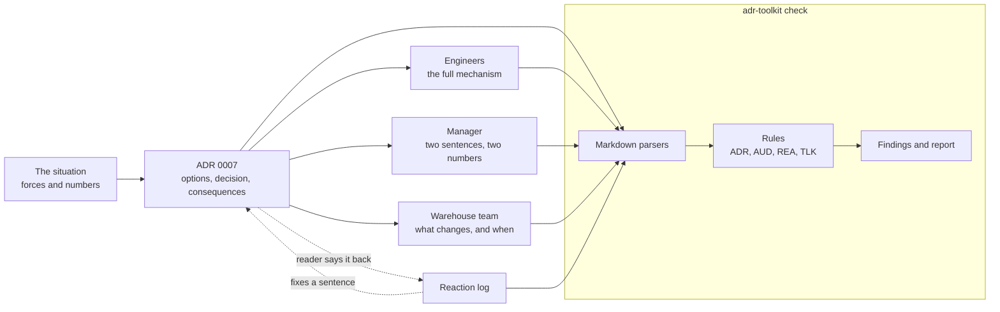

# Architecture: the decision record and its toolkit

Component names match the lesson's diagram ("One decision, three audiences"): **The situation** (the forces), **ADR 0007**, **Engineers**, **Manager** and **Warehouse team**. The toolkit sits beside them and checks each arrow.

## Components and what each owns

| Component | Where it lives | What it owns |
| --- | --- | --- |
| **The situation** | the `## Context` section of [ADR 0007](docs/adr/0007-announce-paid-orders.md) | The forces as facts with numbers and no answer. |
| **ADR 0007** | [docs/adr/0007-announce-paid-orders.md](docs/adr/0007-announce-paid-orders.md) | Options, decision, consequences, one page. |
| **Engineers** / **Manager** / **Warehouse team** | [docs/communication/0007-audiences.md](docs/communication/0007-audiences.md) | One version per reader, each answering that reader's first question. |
| **Reaction log** | [docs/review/0007-reaction.md](docs/review/0007-reaction.md) | The proof the record was tested on a reader and changed. |
| **Decision log** | [docs/decision-log.md](docs/decision-log.md) (generated) | Which record replaced which. |
| **Rules** | `src/adr_toolkit/domain/` | The checks, as pure functions over parsed values. |
| **Parsers** | `src/adr_toolkit/infrastructure/markdown.py` | Markdown text into `Adr`, `AudienceVersions`, `Reaction`. |
| **Use cases** | `src/adr_toolkit/application/` | `check_documents`, `write_log`, report formatting. |
| **Command line** | `src/adr_toolkit/interfaces/cli.py` | `check`, `log`, `report`, and the exit codes (0 ok, 1 findings, 2 bad configuration). |

## Pattern: ports and adapters over a rule engine

The rules are plain functions from a parsed document to a list of findings, so each rule is a unit test with no files. The use case asks for a `DocumentStore` (read, list, write) and a `RecordReader` (Markdown to values); the file system and the Markdown parser are the adapters. Tests swap in an in-memory store. This fits a documentation repository because the part that changes is the rule set and the document formats, and neither should need a disk to be tested.

## Data flow

Drawn versions of this figure and of the walk-through: [the architecture](docs/diagrams/architecture.svg) and [one run](docs/diagrams/flow.svg).

### One run, step by step (`make run`)

1. The command line reads settings from the environment and builds a file-system store rooted at `ADR_ROOT`.
2. The use case lists `docs/adr/*.md` and the parser turns each file into an `Adr`; whatever is missing stays empty.
3. Each record goes through the ADR rules (header, sections, options, context, decision, consequences, page size). Findings carry a code.
4. The links rule compares supersession across records: the replaced record must say who replaced it and the successor must say what it replaced.
5. For every number in `ADR_REQUIRED_COMMUNICATION` (7), the audience file and the reaction log must exist; they are parsed and checked against the record's own text, so the engineer version is tied to the chosen mechanism and the reaction log to the sentence that changed. The talk, if present, is word-counted.
6. The decision log is regenerated in memory and compared with `docs/decision-log.md`.
7. The report is printed (and with `report`, written to `build/report.md`); the exit code is 1 if any finding is an error.

## Decisions and trade-offs

- **Markdown with labeled lines, not front matter or YAML.** The lesson's template is Markdown with `Status:` and `Advantage:` lines. Keeping that format means the record is readable on any host and the linter checks the document people actually write. The cost is a small parser instead of a YAML library; it has no run-time dependency.
- **Form checks, not judgment.** The linter proves a record has a bad consequence and an observable trigger; it cannot prove the options are fair. Rules that guess at meaning (is this a straw man?) would be wrong often enough to be ignored, so they are left to the lesson's checklist and the real reader.
- **Errors and warnings.** Only errors fail the run. The worked-example reaction is a warning because failing the run on it would make the repository permanently red until a real reading exists, and hiding it would be dishonest.
- **The generated log is checked, not trusted.** `check` fails if `docs/decision-log.md` differs from what the records say, so the log cannot lie about what is superseded.
- **Size limits as settings.** One page is 70 lines and 600 words by default; both are environment variables.

## Failure modes the lesson teaches, and how the code shows them

| Mistake (lesson, "Common mistakes") | Rule that catches it |
| --- | --- |
| A straw-man option | ADR006, ADR007, ADR008 |
| Options mixed into the context | ADR009, ADR010 |
| Describing a rejected option unfairly | Same three lines for every option (ADR007); fairness itself is for the reader |
| Only good consequences | ADR013, ADR014, ADR015 |
| The same paragraph in all three versions | AUD008 |
| Skipping the real reader | REA001 to REA004 |

## Limits of the teaching build against a production one

- No review workflow: a real team runs these rules as a pull-request check and requires an approval on any change to an Accepted record.
- Status changes are not validated over time (a record cannot go from Superseded back to Accepted, but nothing stops an edit); git history is the audit trail.
- Jargon lists are short and English-only; a team would keep its own.
- The parsers expect the template's layout. A record in another layout is reported as missing parts, not translated.

## How to extend it

Add a rule as a function in `domain/` that returns findings, call it from the group it belongs to, and give it a code and a unit test. Add a document type by adding a value in `domain/`, a parser method in `infrastructure/markdown.py`, and a branch in `application/check_documents.py`. To use it on a real project, copy `templates/adr-template.md` into the project's `docs/adr/`, set `ADR_ROOT` and run `adr-toolkit check` in CI.
